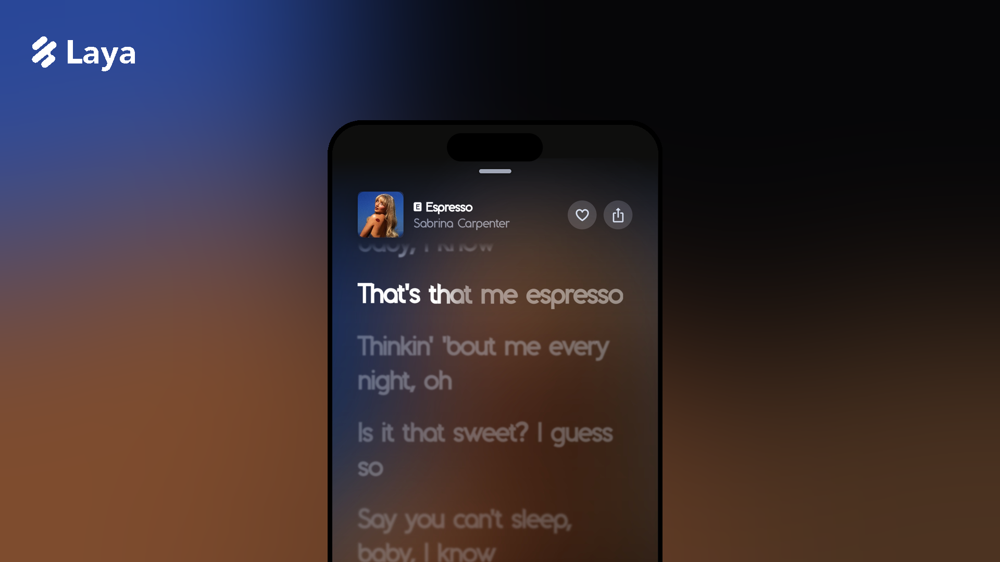

 
 

# Laya

### Aesthetic YouTube Music Client

 

 

[**Download**](#download) · [**iPhone**](#install-on-iphone-with-sidestore) · [**Features**](#features) · [**Disclaimer**](#disclaimer)

 

> [!IMPORTANT]
> Laya is not affiliated with, endorsed by, or connected to YouTube or Google in any way. Use it at your own discretion.

---

<h1>Features</h1>

<table>
  <tr>
    <td width="50%" valign="top">

#### Playback
- **Search, browse and play** anything available on YouTube Music.
- **Hi-Res lossless audio** — FLAC/ALAC from a configured module source, with YouTube Music as fallback.
- **Gapless playback with true crossfade**, adjustable 0–12s.
- **Automix [Beta]** — DJ-style transitions with beat-matching and tempo-stretching.
- **Offline downloads** — save tracks with embedded metadata.
- **Local music library** integration.
- **Background playback** via a proper foreground media session.
- **Apple-like lyrics animation** — credit to [binimum](https://github.com/binimum/am-lyrics).

#### Connectivity & Accounts
- **Sign in with your Google account** for personalized content.
- **Spotify integration** — connect your account to play your playlists and Liked Songs.
- **Discord Rich Presence** — in-app login, live track/artist/album and progress.
- **Scrobbling** to Last.fm and ListenBrainz.
- **Pluggable sources** — add, edit, test and health-check module sources.

    </td>
    <td width="50%" valign="top">

#### Experience
- **Animated album canvas** — motion artwork on the now-playing screen.
- **Word-synced lyrics** — word/syllable-level highlighting from multiple sources.
- **Lyrics providers** — credit to [lrc.red](https://lrc.red), [BiniLyrics](https://github.com/binimum), [BetterLyrics](https://github.com/better-lyrics/better-lyrics), [PaxSenix](https://lyrics.paxsenix.org), [LyricsPlus](https://github.com/ibratabian17/YouLyPlus), [SimpMusic](https://github.com/maxrave-dev/SimpMusic), [Unison](https://unison.boidu.dev), [Megalobiz](https://www.megalobiz.com), [KuGou](https://www.kugou.com), [LRCLIB](https://lrclib.net), [Musixmatch](https://www.musixmatch.com) and [Genius](https://genius.com).
- **Dynamic, artwork-driven theming** — Material palette extracted from album art.
- **Frosted-glass UI** — Telegram-style translucent bars via Haze, Material 3 theming.

#### Controls & Tweaks
- **Per-network audio quality** — separate quality ceilings for Wi-Fi and mobile data.
- **Playback speed control** (0.5×–2.0×) and **skip silence**.
- **Sleep timer** — fixed presets or "stop after this track".
- **System equalizer** integration.
- **Karaoke** — sing along with the vocals taken out by an on-device AI separator (UVR MDX-Net), live from the lyrics page. See [docs/KARAOKE.md](docs/KARAOKE.md).
- **Reverb** — Room, Hall, Plate and Cathedral presets with adjustable decay, pre-delay, damping, mix and width, plus a quick toggle in the player. See [docs/REVERB.md](docs/REVERB.md).
- **Stats for nerds** — codec, bit depth, sample rate, and more on the now-playing screen.

    </td>
  </tr>
</table>

---

<h1>Download</h1>

Grab the latest build for your device from the [Releases](https://github.com/impin2rex/Laya/releases) page.

| Platform | File | Notes |
|---|---|---|
| Android | `Laya-<version>-android-<abi>.apk` | Sideloading requires enabling "Install unknown apps" for whichever app you download it with. |
| Android TV | `Laya-<version>-android-tv-<abi>.apk` | Sideload with `adb install` or a file manager on the TV. |
| Wear OS | `Laya-<version>-wear-os.apk` | Install over ADB / Wi-Fi debugging. |
| Windows | `.exe`, `.msi`, portable `.zip` | Run the `.exe` installer, no admin rights needed. The `.zip` runs from any folder. |
| macOS | `.dmg`, `.pkg` | `arm64` for Apple Silicon, `x64` for Intel. If macOS blocks it, run `xattr -cr /Applications/Laya.app`. |
| Linux | `.AppImage`, `.deb`, `.rpm` | AppImage: `chmod +x` and run. Debian/Ubuntu: `sudo apt install ./Laya-*.deb`. Fedora: `sudo dnf install ./Laya-*.rpm`. |
| iPhone | `Laya-<version>-ios.ipa` | Unsigned, install with [SideStore](#install-on-iphone-with-sidestore). Runs on iPad in iPhone compatibility mode. |

---

<h1>Install on iPhone with SideStore</h1>

The iOS build is an unsigned `.ipa`, so it has to be signed with your own Apple ID. [SideStore](https://sidestore.io) does this on the device and refreshes the app by itself, no computer needed after setup.

1. **Set up SideStore** once by following the official guide at [docs.sidestore.io](https://docs.sidestore.io). It needs a computer for the first install, a free Apple ID, and a local VPN (LocalDevVPN / StosVPN) that SideStore uses to refresh apps.
2. **Enable Developer Mode** on the device: Settings → Privacy & Security → Developer Mode → On, then restart.
3. **Download the IPA** from [Releases](https://github.com/impin2rex/Laya/releases) straight onto the iPhone (`Laya-<version>-ios.ipa`).
4. In SideStore open **My Apps**, tap **+**, and pick the downloaded IPA. Sign in with your Apple ID if asked and wait for the install to finish.
5. Turn the VPN on and open **Laya** from the home screen. If iOS says the developer is untrusted, go to Settings → General → VPN & Device Management and trust your Apple ID.

**Good to know**
- A free Apple ID signs apps for **7 days**. SideStore refreshes Laya in the background while the VPN is on; you can also refresh by hand in My Apps.
- A free account allows 3 active sideloaded apps and 10 App IDs per week. Laya plus its widgets use 2 App IDs.
- To update, install the newer IPA over the old one. Your data stays.
- Laya has iPhone widgets (iOS 17+). On iPad it runs as a scaled iPhone app.

---

<h1>Disclaimer & Legal Notice</h1>

Laya is an independent, community-driven third-party audio player and client. It is **not** associated with Google LLC, YouTube Music, Deezer, Telegram, or any of their parent companies.

* **No Media Hosting:** Laya does not host, upload, or store copyrighted music files. It operates strictly as an interface to scan local device storage or stream media directly from public, public-facing, or user-authenticated APIs.
* **Fair Use & API Usage:** This software is created solely for personal research, educational, and fair-use purposes. The user is entirely responsible for ensuring their usage aligns with their local copyright laws and YouTube Terms of Service.
* **No Ad-Blocking Guarantee:** While Laya focuses on providing a clean listening environment, it does not guarantee permanent bypasses or modifications to commercial third-party platform conditions.
* **Copyleft:** Laya is free software under the GPLv3. The license does not let anyone forbid others from selling or redistributing copies, but any distribution must come with the Corresponding Source under the same license.

---

<h1>License</h1>

This project is licensed under the **GNU General Public License v3.0 (GPLv3)**. See the [LICENSE](LICENSE) file for details.

Laya is a modified version of [BitChord](https://github.com/kushagrasinghx/BitChord), also licensed under GPLv3.

